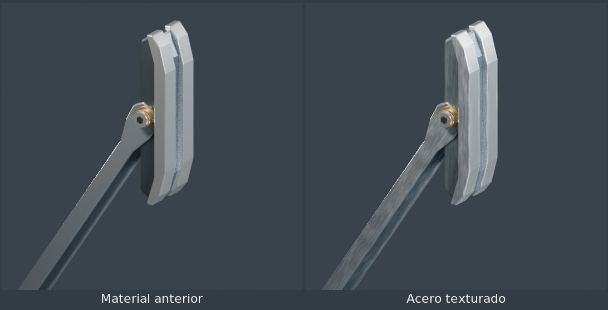
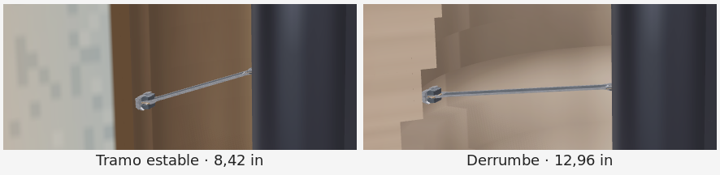

# Calibre articulado

El brazo del calibre se monta sobre la herramienta de densidad cuando está en la sarta. También puede verse sobre su propio cuerpo cuando se usa solo. La ficha bibliográfica describe el mecanismo de contacto. La horquilla, la biela de 16 cm y la zapata son una interpretación geométrica de ese principio, con dimensiones ilustrativas.

## Abrir el modelo

[Modelo editable en Blender](../../../tools/modeling/caliper.blend) · [GLB de la aplicación](../../../src/app/toolString/assets/caliper.glb) · [Render del mecanismo](mecanismo.png)

El editable se abre con el mecanismo armado. El GLB contiene las tres piezas en sus orígenes de articulación. La aplicación coloca los pasadores y la cara de contacto en cada posición. Para reconstruir ambos archivos desde la raíz con Blender 4.3.2:

```sh
blender -b -P tools/modeling/caliper.py -- tools/modeling/caliper.blend
```

## Superficies del mecanismo

La biela lleva cepillado longitudinal. Las cabezas de los pasadores tienen marcas concéntricas de torneado y las dos caras de contacto de la zapata muestran una franja pulida. El casquillo de bronce y la horquilla pavonada tienen acabados propios. El desgaste es ilustrativo.

El generador de Blender crea cinco acabados originales. Cada uno combina tres mapas de 256 × 256 píxeles: color en sRGB, rugosidad y metalicidad por canales, y normales para el relieve fino. Las coordenadas UV se calculan en centímetros antes de articular la biela. El editable y el GLB contienen las 15 imágenes. La comparación usa la misma geometría, luz y cámara en ambas tomas.



## Ver el contacto en el TP

En el visor, cargar **Datos del TP** y elegir el intervalo indicado. Abrir **Sarta → Calibre → Centrar en la vista**. La profundidad de lectura figura en la ficha del calibre. El centro de la ventana está desplazado respecto de la zapata por la posición del calibre en la sarta. Estos intervalos corresponden al orden predeterminado de las herramientas.

| Tramo | Tope y base del visor (m MD) | MD de la zapata (m) |
| --- | --- | --- |
| Estable | 7984,5512–8008,5512 | 7987,7412 |
| Derrumbe | 7705,202–7729,202 | 7708,392 |

El radio local sale de la mitad del diámetro medido. La zapata toca esa pared cuando está dentro del recorrido del modelo. El pivote proximal se desliza a lo largo del cuerpo para conservar el largo de la biela a la profundidad de contacto. Al faltar CAL se usa la pared nominal. La ficha identifica el origen de la apertura y avisa si la pared queda fuera del alcance ilustrativo. La sección es circular y la posición angular del brazo es esquemática. El render de Blender muestra las proporciones físicas del modelo; la vista del pozo aplica la compresión axial 5:1 de la sarta.



| Captura del visor | Claro | Oscuro |
| --- | --- | --- |
| Tramo estable de 8,42 in | [Ver](estable-claro.png) | [Ver](estable-oscuro.png) |
| Derrumbe de 12,96 in | [Ver](derrumbe-claro.png) | [Ver](derrumbe-oscuro.png) |

Las capturas de 1366 × 768 usan el mismo acercamiento. Después de centrar el calibre, cerrar la ficha y pulsar una vez `=` en la escena. Se verificaron ambos temas por HTTP local con la red deshabilitada después de cargar la página. En cada tema, Chromium decodificó las 15 imágenes de 256 × 256 desde el GLB y se observaron 30 cargas de esos mapas en WebGL durante el recorrido de los dos tramos. El navegador solicitó únicamente el HTML. La prueba de apertura directa quedó pendiente por la política de Chromium administrado.

```text
Page.goto: net::ERR_BLOCKED_BY_ADMINISTRATOR at file:///workspace/repo/dist/index.html?inicio=no
```

Pasaron `npm run typecheck`, `npm test` (3871 pruebas) y `npm run build`. El único archivo producido fue dist/index.html, de 10.282.128 bytes.
