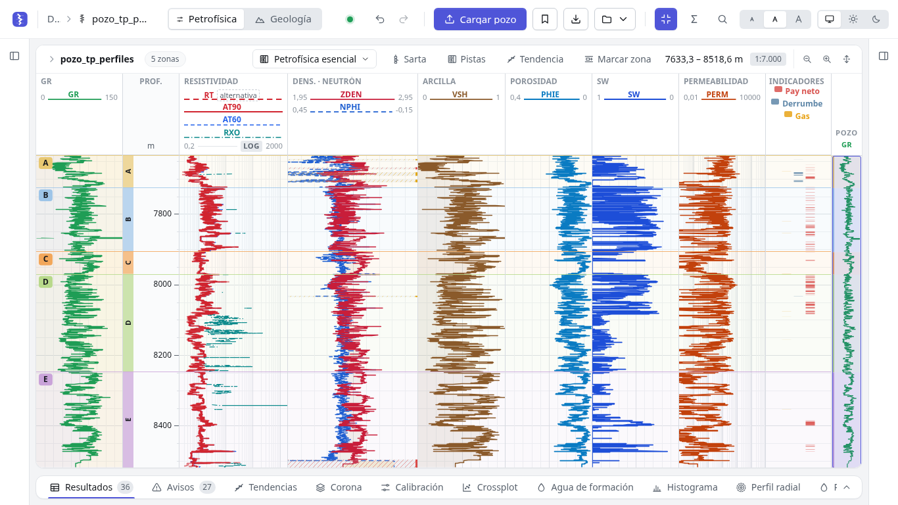
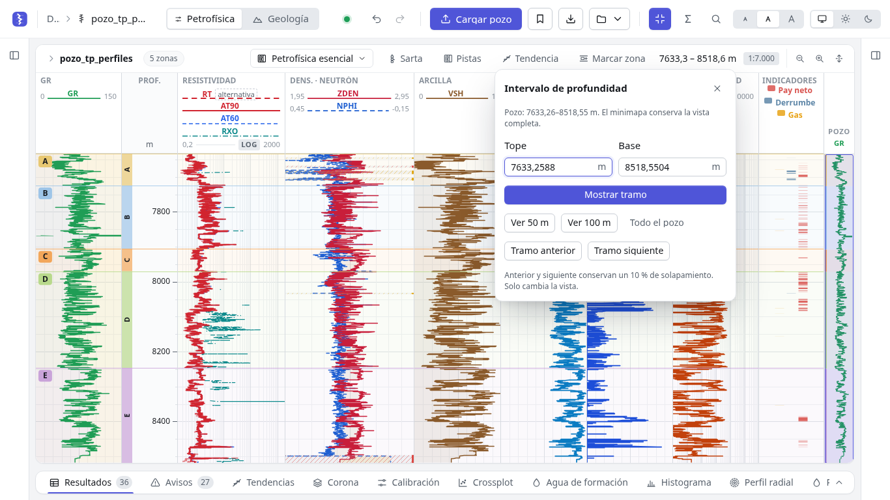
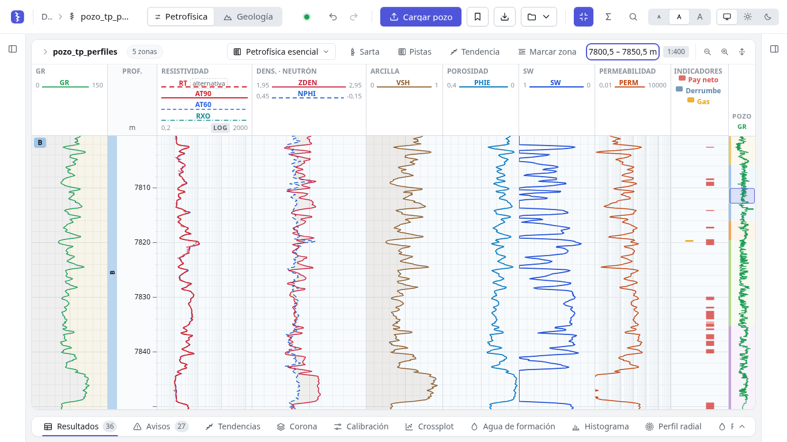

# Intervalos explícitos y lectura en detalle

Fecha: 2026-10-28. Entrega basada en el PR #37, sin integrar ni mergear ese PR o los anteriores. Continúa #34 y el masterplan #33.

## Comportamiento

El minimapa ya ofrecía un panorama del pozo y desplazamiento de la ventana. Esta entrega lo reutiliza y convierte el indicador de rango visible en un botón **Elegir intervalo de profundidad**. No agrega otro renderer ni un segundo visor.

Al pulsarlo, se abre un selector con **Tope**, **Base** y **Mostrar tramo**. Admite coma o punto decimal. Escribir no mueve el perfil: se aplica al confirmar. Escape o clic fuera descartan el borrador; Escape, confirmar y cerrar devuelven el foco al botón. El botón describe el intervalo actual para tecnologías de asistencia.

También permite **Ver 50 m**, **Ver 100 m**, **Tramo anterior**, **Tramo siguiente** y **Todo el pozo**. Los presets se centran en la vista actual y se desplazan hacia adentro junto a los extremos. Anterior/siguiente avanzan el 90 % del intervalo visible para conservar 10 % compartido; se detienen en los extremos sin reducir el ancho. Estos accesos operan sobre la ventana visible, no sobre cambios sin confirmar en los campos.

Rechaza campos vacíos, valores no finitos, orden invertido, profundidades fuera del pozo e intervalos más pequeños que el máximo detalle admitido por el viewport. Los límites se consultan de nuevo al confirmar. No redondea las profundidades al paso de las muestras. Durante un arrastre de elementos del perfil no abre ni aplica el selector. El borrador se descarta cuando cambia la clave de pozo.

Todas las pistas y el minimapa usan el viewport existente. El estado es temporal; no modifica proyecto v6, interpretación, zonas, curvas, historial, preferencias ni motor. Funciona en vista normal y lectura amplia, en Petrofísica y Geología. Los controles de zoom, ver todo y navegación del minimapa existentes se conservan.

## Capturas comparables

TP, preset Petrofísica esencial, lectura amplia, 1366×768. Mismos datos, fuentes y escalas horizontales; cambia únicamente el intervalo vertical.

**Panorama: pozo completo**

**Selector**

**Detalle: 7800,5–7850,5 m**

El minimapa conserva el pozo completo y su rectángulo identifica los 50 m mostrados. El cociente de alturas medido fue 0,05651, coherente con 50 m de un pozo de unos 885 m. El cambio permite leer eventos sin suavizar, limpiar ni alterar las mediciones.

## Validación ejecutada

| Comprobación | Resultado |
|---|---|
| Suite completa, un worker | 2.418 pruebas en 147 archivos, 0 fallos/omisiones |
| Pruebas nuevas | 18: parseo, rechazo de entradas, límites, profundidades negativas, ventanas y viewport compartido |
| Typecheck, build, diff check y sintaxis del verificador Python | Aprobados |
| Regresión del PR #37 | Recorrido reading_viewer.py aprobado; misma geometría normal, lectura amplia, preferencias y exportaciones |
| Selector con teclado | Foco inicial, confirmar con Enter, Escape y recuperación de foco comprobados |
| Escritura/errores | No mueven el viewport ni cambian proyecto; el diálogo informa el error |
| Anterior/siguiente y presets | Rangos esperados y límites comprobados en navegador |
| Minimapa | Rectángulo proporcional, navegación con flecha y clic sin cambiar longitud |
| Proyecto antes/después de navegar | Contenido project idéntico; formato v6 |
| LAS completo antes/después | Idéntico byte a byte |
| SVG de todo el pozo antes/después | Idéntico byte a byte |
| SVG del tramo visible | Respeta el intervalo elegido; subtítulo 7801–7851 m para 7800,5–7850,5 m |
| Chromium claro/oscuro 1366×768, claro 1920×1080 y DPR 2 | Recorrido sin excepciones de página |
| Vista normal, lectura amplia y Geología | Selección de intervalo comprobada |

SHA-256 LAS:

~~~text
ce05261de2da6624cc0d94f2611ec20fe0125b62d15cbb60aafd8808fcca6c2b
~~~

SHA-256 SVG de todo el pozo:

~~~text
6c541751e25ae07ab8850ec8a1d6fe66e3fe748b6ac166d00eeceea1572bcc52
~~~

La igualdad del SVG corresponde a exportar **todo el pozo**; una figura del tramo visible debe respetar el intervalo elegido. HTML autocontenido: 5.410.430 → 5.415.233 bytes (+4.803), sin dependencias nuevas de producción.

Las comprobaciones se ejecutaron sobre el TP en Chromium y por HTTP local. file:// está bloqueado en el navegador administrado; no se certifica doble clic, todos los navegadores o todas las personalizaciones.

## Reproducir

~~~sh
npm run typecheck
npm test -- --maxWorkers=1
npm run build
~~~

Servir por HTTP local el build padre 729a1e9ef268c93ce0d15706845383ad45a766f0 como parent.html y el candidato como candidate.html. Disponer de Python, Playwright y Chromium:

~~~sh
python3 scripts/qa/reading_viewer.py --url http://127.0.0.1:4173/ --output /tmp/pozo-interval-reading --chromium /usr/bin/chromium
python3 scripts/qa/interval_viewer.py --url http://127.0.0.1:4173/ --output /tmp/pozo-interval-navigation --chromium /usr/bin/chromium
~~~

El verificador de intervalos usa la UI visible y conserva capturas, proyectos, exportaciones y evidence.json en la carpeta indicada. No se incluye en producción.

## Estado del plan

Esta entrega agrega selección y recorrido explícitos sobre el panorama existente. Queda el refinamiento visual para otras combinaciones de pistas y cualquier comparación original/preparada, ligada a #32. DRX (#31), preparación/correcciones (#32) y formatos futuros continúan pendientes. La integración de ramas se mantiene separada de la implementación; no se mergeó ningún PR.
