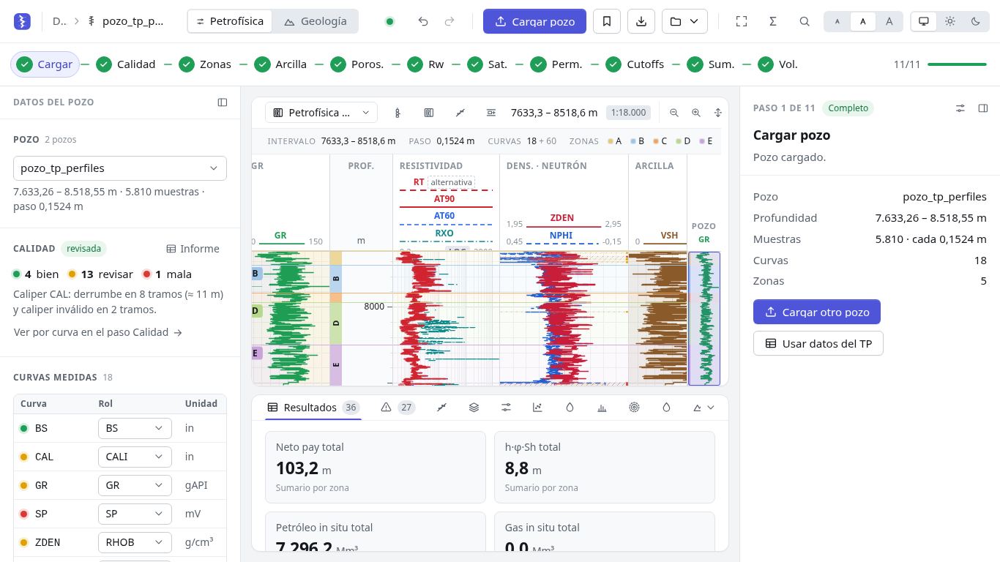
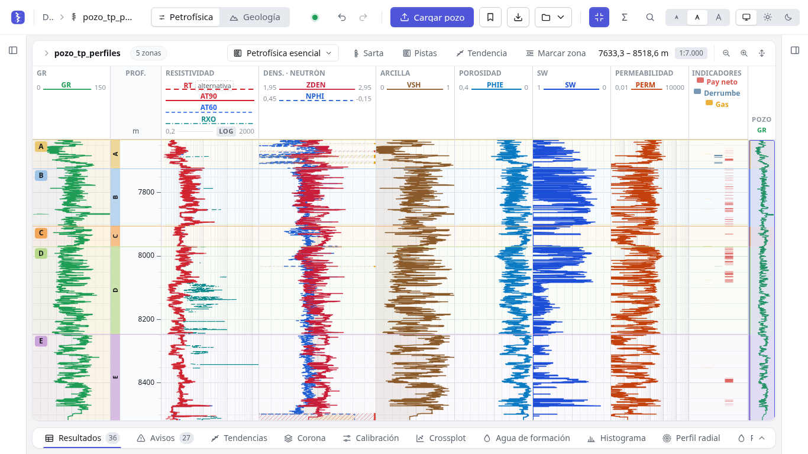

# Lectura amplia reversible

Fecha: 2026-10-28. Entrega sobre el PR #36, que depende del #35. Requisitos: issue #34 y masterplan del PR #33. No modifica main ni completa las herramientas científicas #31/#32.

## Uso y límites de la entrega

Con un pozo abierto, usar el botón de la barra superior **Activar lectura amplia**, o buscar lectura en la paleta de comandos (Ctrl+K / ⌘K). El mismo botón permite **Volver a la disposición anterior**. Se puede activar con teclado. Está deshabilitado durante el armado de pistas, la edición de sarta o un arrastre del visor.

Durante la lectura se ocultan paneles laterales, contenido del dock, cabecera completa del pozo y barra de flujo. Se conservan barra superior, controles del visor, rango, minimapa y accesos a paneles. Abrir un panel, cambiar su disposición o abrir un editor recupera la vista normal antes de aplicar la acción. Se puede cambiar entre Petrofísica y Geología en lectura.

El estado es temporal y se inicia desactivado después de recargar. No reemplaza la disposición del usuario: conserva la referencia de layout y no escribe preferencias transitorias en localStorage. Una acción explícita de panel se aplica a la disposición original. No requiere snapshot, migración ni cambio de formato v6; no entra en el historial del proyecto.

Los encabezados compactos se aplican exclusivamente en lectura amplia, sin reducir globalmente las fuentes. Las leyendas conservan sus textos completos y los accesos a las curvas adicionales; se comprobó el popup de las 47 curvas de la fábrica. La vista normal mantiene la geometría anterior. No se modifican datos, algoritmos, máscaras, fuentes de curvas, suavizado ni renderer de figuras.

## Comparación con los mismos datos

Datos TP, preset Petrofísica esencial, interfaz Normal, 1366×768, rango completo **7633,3–8518,6 m**. Se compara la vista normal del PR #36 con este candidato y luego se activa lectura, sin cambiar el intervalo.

| Medida | Normal | Lectura amplia |
|---|---:|---:|
| Alto útil de perfiles | 183,56 px | 474,86 px |
| Ancho útil de perfiles | 1092 px | 1209 px |
| Alto de encabezados | 132,91 px | 124,64 px |

El área de perfiles gana 291,30 px de alto: **2,59 veces** el alto inicial. El intervalo completo conserva su densidad de datos; panorama/detalle y navegación por un intervalo de trabajo siguen pendientes.

**Normal**

**Lectura amplia**

## Verificación ejecutada

| Comprobación | Resultado |
|---|---|
| Suite completa, un worker | 2.400 pruebas en 146 archivos, 0 fallos/omisiones |
| Pruebas nuevas de estado | 14: restauración, persistencia, paneles, editores, comandos, proyecto v6 e historial |
| Typecheck, build y diff check | Aprobados |
| Vista normal frente al build del PR #36 | Mismos rango, pistas, anchos y geometría del visor |
| Salida de lectura | Recupera exactamente las medidas normales |
| Guardado del proyecto antes/durante lectura | Mismo contenido project y versión 6 |
| Preferencias y recarga | No persiste lectura; conserva también una disposición personalizada |
| LAS completo del padre frente a lectura | Idénticos byte a byte |
| SVG normal frente a lectura | Idénticos byte a byte |
| Chromium: claro/oscuro 1366×768, claro 1920×1080, DPR 1/2 | Recorrido y capturas, sin excepciones de página |
| Teclado, acceso a paneles, editor, Geología y popup de 47 curvas | Comprobados en navegador |

SHA-256 LAS:

~~~text
ce05261de2da6624cc0d94f2611ec20fe0125b62d15cbb60aafd8808fcca6c2b
~~~

SHA-256 SVG normal/lectura:

~~~text
6c541751e25ae07ab8850ec8a1d6fe66e3fe748b6ac166d00eeceea1572bcc52
~~~

HTML autocontenido: 5.408.263 → 5.410.430 bytes (+2.167). Sin dependencias nuevas de producción.

El navegador administrado bloquea file://: las comprobaciones usaron HTTP local. No se certifican apertura por doble clic, todos los navegadores ni todas las combinaciones posibles de personalización. Los resultados de igualdad de exportación corresponden al conjunto TP ensayado.

## Reproducir

~~~sh
npm run typecheck
npm test -- --maxWorkers=1
npm run build
~~~

Disponer de Python, Playwright y Chromium. Generar el HTML del padre f9efa7b72aeb44fd1d40ad00acddc3aba706da8a como parent.html y el candidato como candidate.html en una carpeta temporal, y servirla por HTTP local. Ejecutar:

~~~sh
python3 scripts/qa/reading_viewer.py --url http://127.0.0.1:4173/ --parent parent.html --candidate candidate.html --output /tmp/pozo-reading-review --chromium /usr/bin/chromium
~~~

El script opera por la interfaz visible y guarda evidence.json, capturas, proyectos y exportaciones en la carpeta indicada. No se incluye en producción. Las capturas de este documento corresponden al build final, sin avisos superpuestos.

## Pendiente en el plan

Revisión e integración por orden de dependencia #35 → #36 → esta entrega; panorama/detalle y navegación del intervalo. Continúan pendientes la calibración con DRX (#31) y la preparación/corrección de datos (#32), con trazabilidad, límites físicos y validación específica antes de afectar cálculos. Esta entrega no cambia el estado de implementación de esas herramientas.
