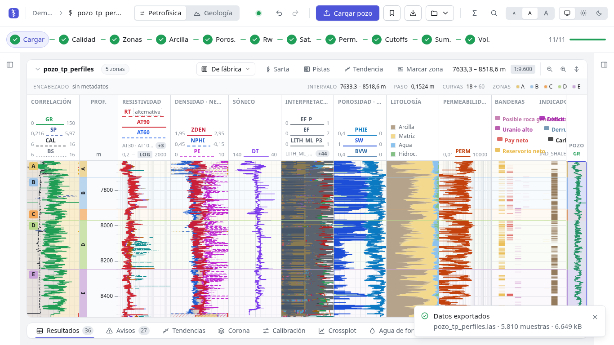
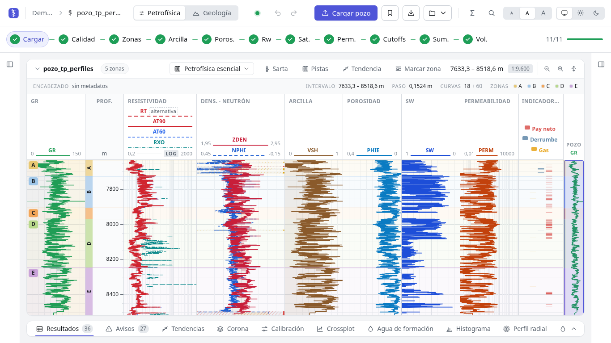

# Primera entrega: Petrofísica esencial, opcional

Fecha: 2026-10-28. Depende de la [línea base](2026-10-28-linea-base.md), PR #35. Requisitos: issue #34 y masterplan del PR #33. No completa el rediseño ni los requisitos científicos #31/#32.

## Comportamiento

En el selector de plantillas del visor, elegir **Petrofísica esencial**. La selección incorpora GR, profundidad, resistividades RXO/RM/RT, densidad–neutrón, Vsh, porosidad efectiva, Sw, permeabilidad e indicadores de gas/derrumbe/pay. Porosidad y Sw tienen pistas separadas. Las pistas calculadas se ocultan si no tienen curvas disponibles.

La nueva selección no incluye recolectores automáticos. PE, DRHO, sónico, mineralogía, curvas de RMN y otras salidas continúan disponibles en **Pistas / Armar pistas**, en las plantillas propias y en los paneles. Las pistas aportadas por módulos, como MDT, siguen usando el descubrimiento existente. Los selectores de rol conservan su comportamiento de curvas medidas y alternativas; la vista no cambia qué fuente alimenta la interpretación.

La plantilla **De fábrica** conserva su definición y sigue siendo la predeterminada. Para volver, elegirla en el mismo menú. Deshacer recupera exactamente la disposición previa, incluidas las pistas personalizadas. Elegir el preset no borra las plantillas propias.

El preset se guarda en display.layouts con el formato existente v6. Abrir un archivo sin pistas propias sigue usando la fábrica; abrir uno con pistas propias las conserva. No se modifica Well, Interpretation, fuentes, parámetros, máscaras, resultados, serialización ni el renderer.

## Comparación visual

Datos TP, interfaz Normal, 1366×768, rango completo 7633,3–8518,6 m, paneles colapsados en ambas capturas:

**Clásica**

**Esencial**

En la prueba, el preset pasa de once grupos a nueve y elimina de esta vista la pista con 47 curvas mezcladas. Sin paneles, las pistas aprovechan el ancho disponible; con paneles abiertos continúa el scroll horizontal. La altura de dibujo con paneles abiertos sigue siendo de unos 184 px: esta entrega no resuelve el reparto vertical, el modo amplio en un botón ni el panorama/detalle. Se conserva también algún truncamiento de títulos; esos puntos siguen pendientes en #34.

Los datos ruidosos y el intervalo completo siguen mostrando una alta densidad. No se suavizaron ni limpiaron las mediciones para mejorar las capturas.

## Verificación ejecutada

| Comprobación | Resultado |
|---|---|
| Base aislada + caracterización clásica | 2.373 pruebas, 144 archivos, 0 fallos/omisiones |
| Candidato + 13 pruebas nuevas | 2.386 pruebas, 145 archivos, 0 fallos/omisiones |
| Typecheck y build | Aprobados |
| Datos y parámetros al cambiar la vista | Mismas referencias en el estado; motor sin módulos recalculados |
| Arrays, fuentes y columnas de exportación en el TP | Sin cambios; catálogo conserva curvas adicionales |
| Guardar/abrir v6; archivos antiguos sin pistas propias | Conservan selección o fábrica según corresponda |
| Undo/redo y vuelta a fábrica | Comprobados en pruebas y navegador |
| Figura SVG | Generada por el motor existente, sin NaN/undefined/Infinity; pistas del preset |
| Chromium 1366×768 y 1920×1080, claro/oscuro; DPR 1/2 | Recorridos y capturas ejecutados; sin excepciones de página |
| Vista clásica inicial del candidato frente al build base | Mismos encabezados, anchos, rango y geometría medidos |
| Exportación LAS completa por UI, antes/después | Archivos idénticos, mismo SHA-256 |

SHA-256 del LAS de referencia y el exportado con el preset:

~~~text
ce05261de2da6624cc0d94f2611ec20fe0125b62d15cbb60aafd8808fcca6c2b
~~~

Build autocontenido: 5.406.115 bytes base → 5.408.263 bytes candidato (+2.148 bytes), sin dependencias nuevas de producción. La suite se ejecutó con un worker para evitar la contención observada en la prueba de rendimiento de Monte Carlo; no se alteraron sus umbrales.

file:// está bloqueado por el navegador administrado: los builds se comprobaron por HTTP local. No se certifica apertura por doble clic, todos los navegadores ni todas las combinaciones de personalización.

## Reproducir

~~~sh
npm run typecheck
npm test -- --maxWorkers=1
npm run build
~~~

Para el recorrido automatizado, disponer de Python, Playwright y Chromium. Generar el build de main 4f187f6 como baseline.html y el de este cambio como candidate.html, ambos dentro de una carpeta temporal; servir esa carpeta por HTTP local. El verificador descarga proyectos, LAS y SVG y compara datos, vista clásica, historial, relectura y Geología:

~~~sh
python3 scripts/qa/essential_viewer.py --url http://127.0.0.1:4173/ --baseline baseline.html --candidate candidate.html --output /tmp/pozo-essential-review --chromium /usr/bin/chromium
~~~

Los artefactos completos quedan en la carpeta indicada. El script no es una dependencia de la app y no se incluye en el HTML de producción. La suite de tests contiene comprobaciones de estado, cálculo, catálogo y figura, y el recorrido de navegador comprueba además el flujo real de exportación/guardado.

## Próximo paso acotado

Revisar encabezados y espacio vertical sobre este preset opcional, con las mismas comparaciones. El modo amplio debe reutilizar los controles de disposición existentes. Los cambios científicos y la preparación de datos se mantienen en entregas separadas.
